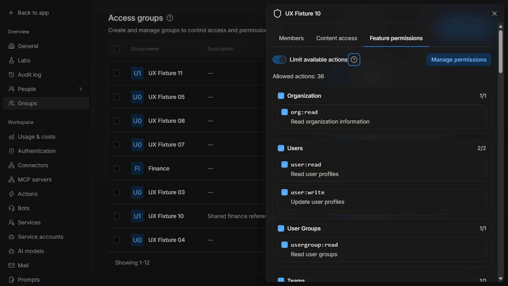
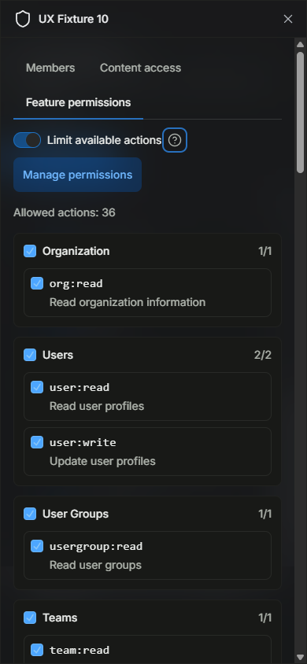
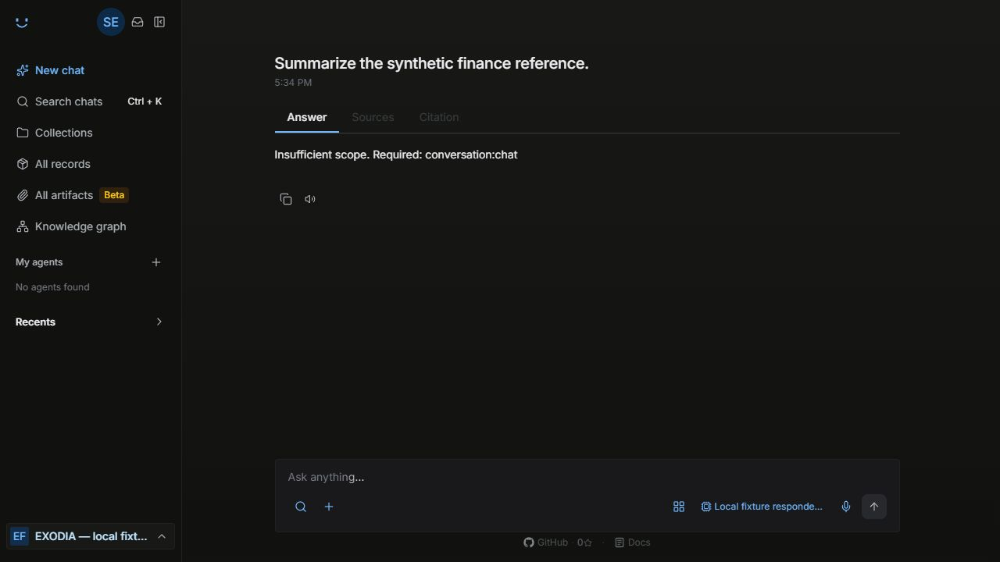
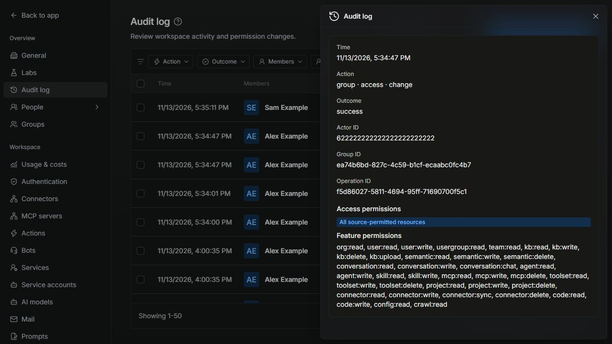

# Native group scope controls

Tracked in [EXO-1143](https://linear.app/exodiatech/issue/EXO-1143), under [EXO-676](https://linear.app/exodiatech/issue/EXO-676). Verified locally on 13 November 2026.

Requested scope: reuse the native OAuth scope catalogue and enforcement for access-group feature limits. Keep content permissions, organization roles and token grants as independent upper limits.

## Contract

- No feature policy means existing behavior. A configured policy is an allowlist of native member-eligible action scopes; an empty list denies scoped actions.
- Every applicable group's allowlist must allow an action. Removing a restriction cannot override another group's restriction. Groups do not confer admin rights.
- Native scope checks keep their existing OR semantics, but one action must be allowed by both the effective group limit and the token grant. Direct Python routes and MCP must apply the same restriction.
- Live admins bypass group feature limits for recovery; their OAuth/PAT scopes still apply. Service-account identities do not become admins.
- Registered Slack/delegated callers use their live group ceiling, without administrator recovery. The existing explicitly signed virtual service-account bridge has no human membership: it retains native configured-bot authorization and cannot load project context. Personal group enforcement requires a registered user identity. System-only indexing/service tokens retain their existing service-scope policy.
- Resolve membership and policy live; never trust a client scope-limit claim. Policy read failure denies the scoped operation. Existing sign-in audit outage behavior is unchanged.
- Store the optional feature allowlist alongside the existing resource policy and revision. Existing content-policy saves preserve the allowlist. Admin writes use the existing permission-change audit path.

## Implementation and verification

The Feature permissions tab uses the existing OAuth catalogue, with identity, refresh and administrator-only scopes excluded. Its selector is shared with personal-access-token creation. Content access remains a separate tab. No new permission catalogue, dependency, credential or database collection is introduced.

The optional `featureScopes` field shares the content policy's revision and compare-and-swap write. Legacy content-only saves preserve it. The existing `group.access.change` audit event records `resource_policy.feature_scopes` and the audit detail/export includes it.

Node resolves live policy on the first native scope check (and MCP entry), once per request. Unscoped identity, sign-out and role recovery remain available during a policy outage. MCP tool availability uses the intersection and refuses group-denied tools without suggesting broader OAuth consent. Python's native scope dependency applies the same live ceiling, including named-agent and delegated registered-user calls.

Project context uses effective scopes rather than raw token scopes. Internal bot hydration checks the registered caller before loading project context. Scheduled agents check the owner's current action/project scopes before reading context and again immediately before dispatch; they never inherit an administrator exemption.

### Boundaries

- These controls limit actions already covered by native OAuth guards. They do not invent new scopes for every UI button or external tool.
- Existing roles, token grants, project grants and content/source ACLs remain authoritative. Group scopes cannot add rights or override another group's restriction.
- Existing in-flight streams are not cancelled retroactively; subsequent requests and scheduled dispatches recheck live policy.
- Virtual service-account bots are not authenticated human group members. Their native configured-agent authorization remains unchanged; do not present that mode as personal authorization.
- Local fixture checks use synthetic identities, connectors and a deterministic responder. No company data or external model is used.
- Roll out matching Node and Python builds together. A rollback to code that predates these guards ignores saved feature limits; treat that as an authorization change, not a transparent rollback. This draft has not been combined with newer main or tested live.

The original application/build source was `f0be6f0d3`; the following results describe that candidate. Release validation against newer main is recorded separately below. Deployment must be confirmed from the running application's build metadata.

| Check | Confirmed result |
| --- | --- |
| Full backend suite, Linux Node 24.22.1 | 15,379 passed; 63 existing pending tests; coverage thresholds unchanged |
| Backend coverage | Statements/lines 90.67%, branches 85.03%, functions 90.48% |
| Full frontend suite, Linux Node 22.23.5 | 5,336 passed across 521 files; coverage thresholds unchanged |
| Frontend coverage | Statements 62.05%, branches 57.01%, functions 57.89%, lines 63.5% |
| Focused Python authorization and native route-scope checks | 156 passed; 22 existing warnings |
| Authenticated cross-service scenarios, Mongo 8.0.9 + Neo4j 5.26.0 | 7 passed, including source ACL, live scope changes, audit and revision conflicts |
| Node 24 type validation and production static frontend build | Passed with normal Next lint/type checks; all 77 routes exported |
| Node 24 backend production build | Passed (`tsc` and native build-info writer) |
| Locale parity and literal translation keys | Passed for all 11 locales |
| Python lint comparison against previous PR head | 0 introduced findings; existing touched-file findings reduced from 25 to 24 |

The final Linux suites use locked dependencies in disposable containers with no host mounts, published ports or Docker socket. Heavy checks run sequentially. The static build uses `ELECTRON_STATIC=1`, matching the Dockerfile, with one build worker to fit the local memory budget. The full frontend run precedes the removal of one unused import; the Node 24 static build includes that cleanup. Earlier Windows runs hit symlink privileges and heap limits. An incomplete Linux fixture archive and two old internal-chat fixture mocks were corrected before the final passing backend run. No coverage gate was reduced.

### Security checks

Authenticated Node-to-Python-to-Neo4j/Mongo scenarios verify policy persistence, preservation by old content-only clients, live revocation and membership changes, overlapping group ceilings, rejection of unknown/admin/duplicate scope names, forged claims, administrator recovery, outage behavior and revision conflicts. Existing content tests continue to reject forbidden record downloads and keep search results/citations within the permitted channel.

Native guard tests cover sessions and OAuth/PAT intersections, including disjoint alternatives that must not accidentally satisfy an OR guard. Python HTTP tests cover named agents, universal chat, delegated registered-user service tokens, signed native virtual service-account compatibility and rejection of regular-token privilege claims. Policy-response tests refuse malformed, missing, oversized or unknown scope lists rather than interpreting them as unrestricted.

Regression tests first reproduced the identity/logout outage, raw project-scope bypass, internal bot project-context bypass, and system/virtual-service compatibility failures. Scheduled project runs are denied before context access and rechecked before model dispatch. Existing API roles, tenant isolation, content ACL and concurrent-save assertions remain in place.

### Browser evidence

Actual local Next.js/Express UI, using Alex Example and Sam Example synthetic fixtures. No company sources or external model were contacted.

- Saved a group limit excluding chat and agent execution. Sam's chat returned the native `conversation:chat` denial. Restoring only chat allowed the next request, without signing in again; the deterministic response contained only the permitted finance fixture.
- Verified keyboard checkbox selection, unsaved-tab navigation confirmation, Continue editing, Cancel, policy preservation in the Content access tab, and the scope list in a successful permission-change audit record.
- Verified 1280px desktop and 390×844 touch layout, readable wrapping tabs, no page overflow, 44px touch targets, accessible help and restored desktop sizing.

## Standards

Independent read-only review: no remaining actionable Standards findings in the final source candidate. Reviewed native component reuse, touch controls, the scoped service boundary, caller compatibility, OpenAPI coverage and malformed-response tests. Reviewers did not independently execute tests or browser checks.

## Spec

Independent read-only review: no remaining actionable Spec findings within the documented identity boundary. Earlier findings on named agents, project context, internal bot hydration and native service-account compatibility were corrected and regression-tested.

Standards: 0 remaining findings. Spec: 0 remaining findings. Real Slack bootstrap, external OAuth/MCP clients and deployment are not verified by these local fixture checks.

## PR #55 release validation

Combined with main `ea6a6775d72200d299b952cf3de9f843d734b895` before release, preserving subsequent usage and Slack changes. Review found that newly added active-run steering also needed the live action ceiling. Node now checks the hydrated actor before forwarding; Python checks the server-stored run kind inside the inbox lock before enqueueing. Named and legacy runs require `agent:execute`; malformed metadata fails closed. Client run-kind claims cannot weaken the check. These checks do not cancel an already-running stream.

Regression tests reproduced the named-agent steering bypass before the fix. Focused Node steering/chat/scoped-request tests passed (81); Python scope/inbox/route tests passed (39), including forged run metadata, legacy state and rejected updates leaving the inbox unchanged. Independent read-only Spec review found no remaining concrete blocker; Standards review requested the matching steering OpenAPI authorization descriptions, which were updated.

Release checks also repaired the OpenAPI validation errors without changing existing operation IDs or SDK export selections, refreshed stale permission-matrix source anchors, and expanded the admin-route inventory for the audited group middleware and literal loop routes. Pinned Spectral 6.17.0 reported zero errors; permission-matrix checks passed (8, with one existing expected failure); the integration guard suite passed (82, with one existing skip).

Other observed GitHub failures are not evidence of a successful check: PostgreSQL store/migration jobs fail during setup; Dependency Review reports unavailable Dependency Graph support; connector oracle checks include five existing Linear synthetic-folder classification failures. The self-hosted core workflows on this draft were queued. No CI gate, coverage threshold or runner access policy was weakened.
