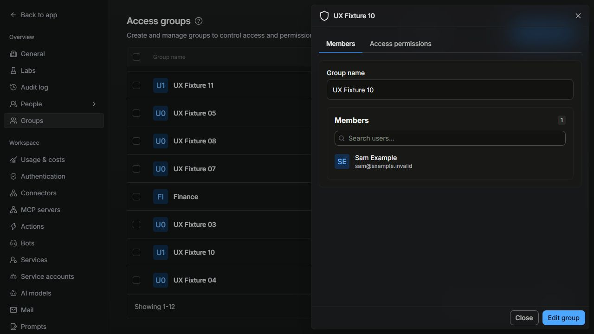
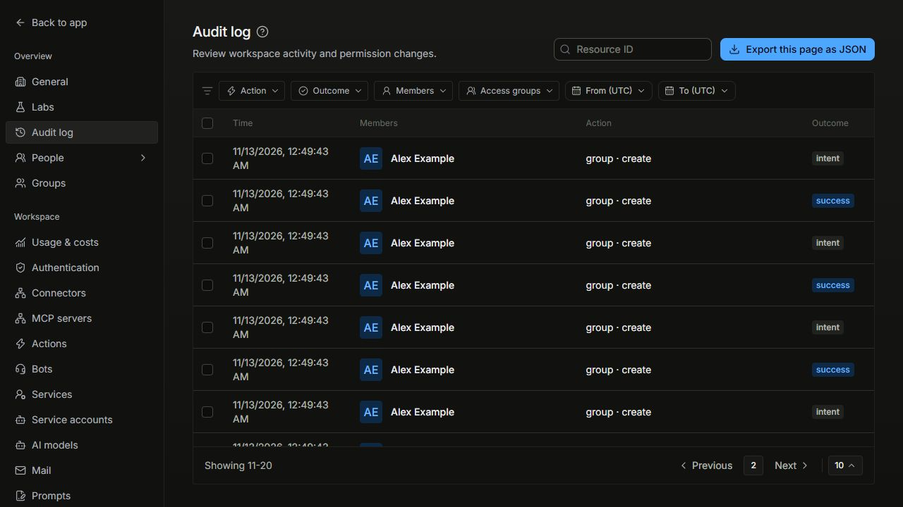
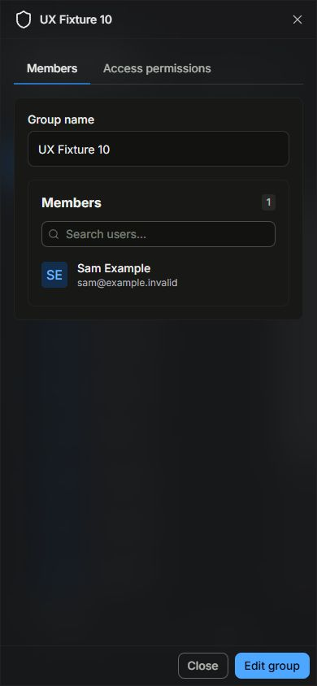
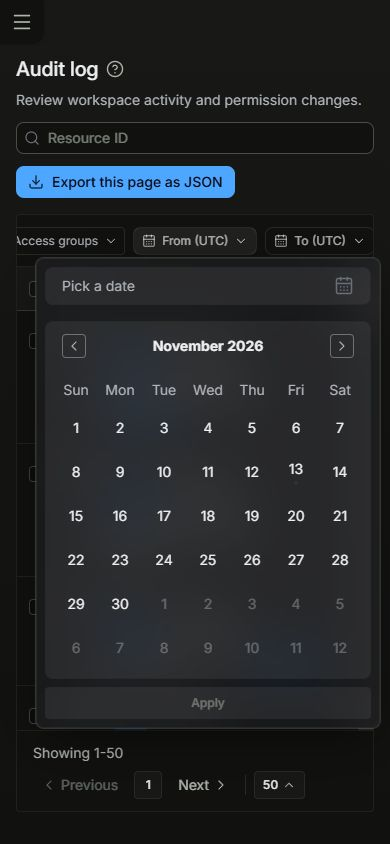

# Groups and Audit UI consistency

Verified locally on 13 November 2026. Tracked in [EXO-676](https://linear.app/exodiatech/issue/EXO-676) and [EXO-463](https://linear.app/exodiatech/issue/EXO-463).

Groups and Audit reuse the workspace header, data table, pagination and drawer used by Users and Teams. Groups also reuse `FormField`, `GroupNameInput`, `PaginatedMembersList` and `SearchableCheckboxDropdown`. Access groups retain their own API, shield icon, permissions tab and source-permission rules; Teams remain collaboration groups with their existing roles.

The Groups and Audit APIs do not supply exact totals. `EntityPagination` shows the returned range, page number, Previous/Next and the same page-size menu without inventing a total. Audit retains its server cursors. Size/filter changes reset cursor history and selections. Groups use a bounded one-row lookahead when a page is full; their existing ID ordering and page-local search remain unchanged. Failed page requests keep Previous and page-size recovery available.

Group names and membership edits are staged until **Save edits**. Cancel restores the saved view, and leaving with drafts asks for confirmation. Saves use the existing API in sequential batches of at most 500 member IDs. A save is not atomic: confirmed batches are removed from the draft; an unsuccessful batch remains for review/retry. A session change stops subsequent operations. Permission rules retain their separate save and revision checks.

The shared people picker now supports keyboard opening, arrow navigation, selection, and Escape with focus restoration. Escape dismisses the picker before the containing drawer. This correction applies to its existing Users, Teams and Groups callers. `AGENTS.md` now names the shared controls and requires a comparison with the reference screen before finishing workspace UI work.

## Verification

- Final Linux frontend coverage run: **5,330 passed / 520 files**; no failed or skipped tests. Coverage: statements **61.72%**, branches **56.74%**, functions **57.51%**, lines **63.15%**; existing thresholds unchanged.
- Final production build, frontend type validation, and locale parity/key checks passed. Both added strings are present in all 11 supported locales.
- **39 real-service API security tests** passed against disposable MongoDB and Neo4j fixtures: administrator/tenant isolation, audit failures, replay protection, cursor filtering, access revocation and concurrent policy revisions.
- **30 focused UI tests** passed, including failed-page recovery on both screens, save/cancel, partial failures, session changes, and 501 rendered members producing request sizes **500, 1, 1** after failure and retry.
- Real local screens checked at desktop and 390px mobile width: paging and page sizes, group membership save/cancel, keyboard selection and picker dismissal, permission hierarchy, audit details, UTC date selection and touch help. Document width matched viewport width. Normal desktop previews were restored; no observed uncaught client exceptions.

The failed-page and 501-member tests reproduced both review findings before their corrections. The picker test also reproduced Escape reaching the containing drawer before the shared fix. Full test logs and build output remain in the maintainer workspace under `deployment/groups-audit-ui-*`.

## Standards

No remaining actionable Standards findings in the corrected implementation. The review's failed-page recovery finding was reproduced and fixed.

## Spec

No remaining actionable Spec findings in the corrected implementation. The review's membership-limit finding was reproduced and fixed. Reviewers inspected the code and regression assertions; test execution and browser checks were performed separately.

Standards: **0 remaining findings**. Spec: **0 remaining findings**.

## Screenshots

All names, email addresses, groups and events below are synthetic local fixtures. These are real application screens, not mockups or production evidence.

## Boundaries

This change contains frontend controls and agent guidance. It does not change backend authorization, source ACLs, audit storage or retention, or deploy the pending upstream merge. Local verification does not establish live-provider behavior, a new production rollout, full Python type cleanliness or backup/restore readiness.
